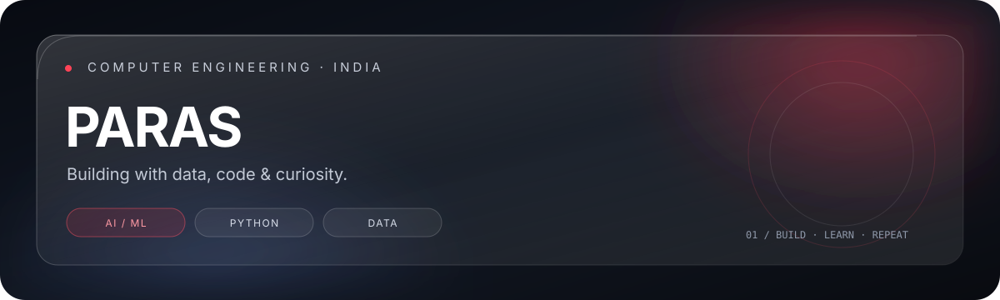

  
  
  

---

## About

I'm a Computer Engineering student interested in **AI/ML, data analytics, and practical software development**. I enjoy taking ideas from notebooks and prototypes toward useful, working applications.

- 🌱 Currently strengthening my foundations in machine learning, Python, SQL and data analytics.
- 🔭 Building projects that combine data, automation and thoughtful engineering.
- 🎯 Focused on becoming internship-ready through consistent learning and hands-on work.
- 🤝 Open to collaborating on meaningful projects.

## Tech stack

  

## Selected projects

<table>
<tr>
<td width="50%" valign="top">

### ⚡ CarbonIQ
Electricity consumption analysis and machine learning experiments using household-level data.

**Focus:** Python · Pandas · Scikit-learn · Forecasting

<a href="https://github.com/teertheparas01/CarbonIQ">View repository ↗</a>

</td>
<td width="50%" valign="top">

### 🏬 StorePulse
A smart retail project focused on useful insights and intelligence for retail operations.

**Focus:** Software development · Data · AI

<a href="https://github.com/teertheparas01/StorePulse">View repository ↗</a>

</td>
</tr>
<tr>
<td width="50%" valign="top">

### 💬 SMS Spam Detection
A machine learning project to classify SMS messages as spam or legitimate.

**Focus:** Python · NLP · Classification

<a href="https://github.com/teertheparas01/SMS-Spam-Detection">View repository ↗</a>

</td>
<td width="50%" valign="top">

### ❤️ Heart Failure Prediction
A predictive modelling project exploring machine learning approaches to clinical data.

**Focus:** Python · SVM · Machine Learning

<a href="https://github.com/teertheparas01/heart-failure-prediction">View repository ↗</a>

</td>
</tr>
</table>

## GitHub overview

 

## Contribution trail

---

*Learning in public. Building one project at a time.*

