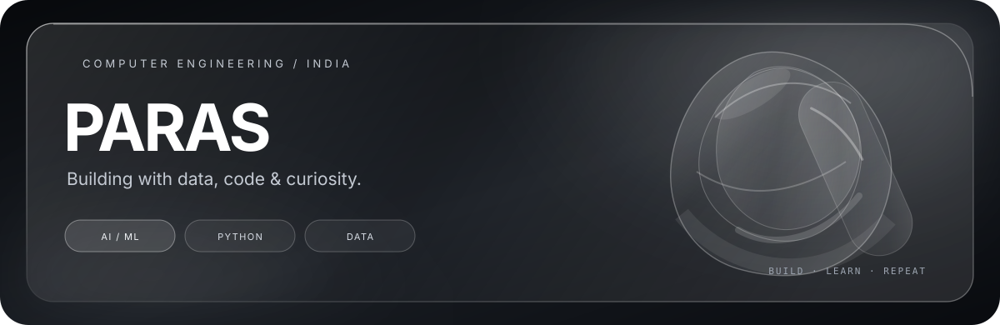
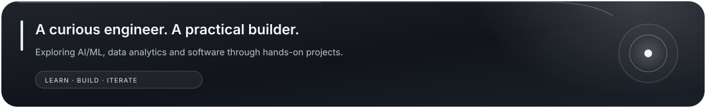
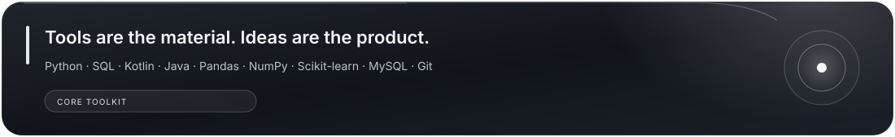
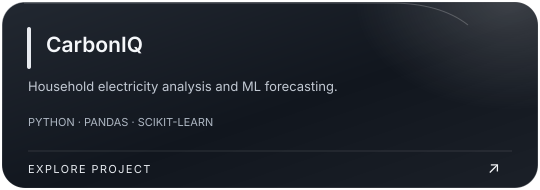
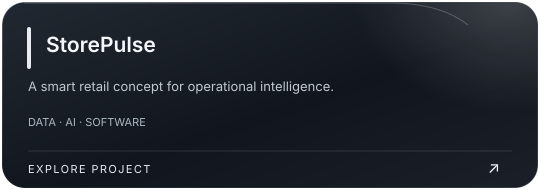
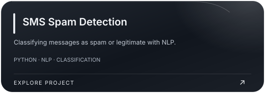
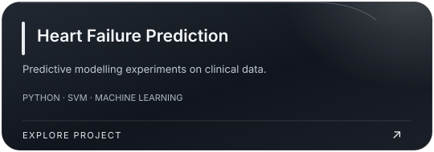
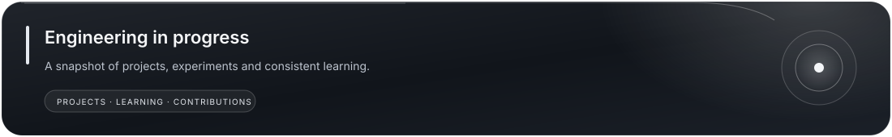

  
  
  

---

## About

- Strengthening my foundations in machine learning, Python, SQL and data analytics.
- Building projects that combine data, automation and thoughtful engineering.
- Focused on becoming internship-ready through consistent learning and hands-on work.
- Open to collaborating on meaningful projects.

## Tech stack

  

  

## Selected projects

<table>
<tr>
<td width="50%" align="center"></td>
<td width="50%" align="center"></td>
</tr>
<tr>
<td width="50%" align="center"></td>
<td width="50%" align="center"></td>
</tr>
</table>

## GitHub overview

  

## Contribution trail

---

*Learning in public. Building one project at a time.*

